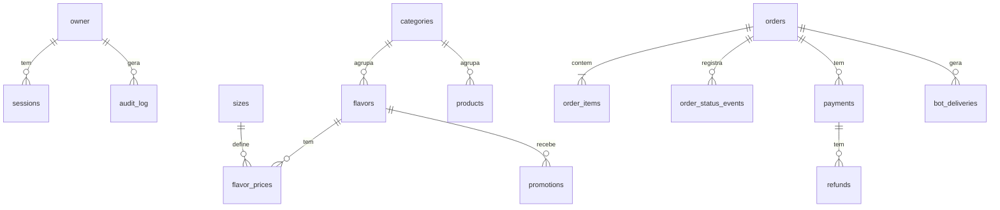

# DATABASE — Forno Bella Pizzeria

Status: **rascunho para aprovação** · Gerado em 25/11/2026 · Postgres (Supabase). Uma base por cliente.

## 1. Convenções

- Chaves `uuid` (geradas no banco), exceto o número do pedido, que também tem um sequencial legível.
- **Dinheiro em centavos** (`integer`), sempre com sufixo `_cents`.
- Datas em `timestamptz` (UTC no banco; exibidas em America/Sao_Paulo).
- Nomes de tabela e coluna em inglês, minúsculos, com `_`. Textos mostrados ao cliente em português.
- **RLS ligada em todas as tabelas, sem política para `anon` e `authenticated`.** Só a chave de serviço (usada pela função `api`) acessa. O acesso público ao cardápio é feito pela função.
- Itens com `active` e `paused`: `paused` = pausado pelo dono (aparece "Indisponível"); `active=false` = removido do cardápio sem apagar o histórico.
- Pedidos guardam **cópia dos dados do item** (nome, preço, sabores), então mudar o cardápio não altera pedidos antigos.

## 2. Diagrama (resumo)

## 3. Tabelas

### 3.1 Acesso
**`owner`** (uma linha)
| Coluna | Tipo | Notas |
|---|---|---|
| id | uuid PK | |
| email | text unique | em minúsculas |
| password_hash | text | Argon2id (ou alternativa medida na Fase 0), com salt e parâmetros no próprio texto |
| totp_secret_enc | text null | segredo do autenticador, **criptografado** com `APP_SECRET_KEY` |
| totp_enabled | boolean | padrão false |
| recovery_codes_hash | text[] null | códigos de recuperação, só o hash |
| created_at, updated_at | timestamptz | |

**`sessions`**
| Coluna | Tipo | Notas |
|---|---|---|
| id | uuid PK | |
| owner_id | uuid FK | |
| token_hash | text unique | SHA-256 do ID aleatório (o ID puro só existe no cookie) |
| csrf_token_hash | text | |
| created_at, last_seen_at | timestamptz | |
| idle_expires_at | timestamptz | prazo deslizante (renovado a cada uso) |
| absolute_expires_at | timestamptz | limite absoluto da sessão |
| user_agent | text | resumido; sem IP completo |

**`rate_limits`**: `key text`, `window_start timestamptz`, `count int`, PK (`key`,`window_start`). Chaves como `login:email:<hash>`, `login:ip:<hash>`, `order:phone:<hash>`, `order:ip:<hash>`. Guarda **hash**, não o dado bruto.

### 3.2 Loja
**`store_settings`** (uma linha)
| Coluna | Notas |
|---|---|
| name, logo_url, story_text | identidade |
| phone, whatsapp, social jsonb | contatos |
| address_text, lat, lng | endereço da loja |
| delivery_radius_km numeric | raio máximo |
| min_order_cents int null | null = sem mínimo |
| free_shipping_above_cents int null | null = desligado |
| est_delivery_min, est_delivery_max, est_pickup_min, est_pickup_max int | minutos |
| pix_expiry_minutes int | padrão 15 |
| bot_webhook_url text null | vazio na demonstração |
| bot_webhook_secret_enc text null | segredo de assinatura, criptografado |
| theme jsonb | preset escolhido e as 4 cores da Personalizada |
| privacy_policy_text text, privacy_policy_version int | texto editável e versão |
| consent_text, consent_text_version int | texto da caixa do checkout |
| is_demo boolean | habilita o reset |
| timezone text | padrão America/Sao_Paulo |

**`opening_hours`**: `weekday smallint (0–6)`, `opens time`, `closes time`, `closed boolean`. Se `closes <= opens`, o horário passa da meia-noite (RN-08). Um período por dia.

**`delivery_fee_bands`**: `id`, `from_km numeric`, `to_km numeric`, `fee_cents int`, `sort int`. Regra: faixas contíguas e crescentes; `to_km` da última = `delivery_radius_km` (validado ao salvar).

### 3.3 Cardápio
- **`categories`**: `id`, `name`, `kind` (`pizza_salgada` | `pizza_doce` | `drink` | `other`), `sort`, `active`.
- **`sizes`**: `id`, `name` (Broto, Grande), `slices int`, `max_flavors int`, `sort`, `active`.
- **`flavors`**: `id`, `category_id` (salgada ou doce), `name`, `description`, `ingredients text[]`, `photo_url`, `paused bool`, `active bool`, `sort`.
- **`flavor_prices`**: `flavor_id`, `size_id`, `price_cents`; PK (`flavor_id`,`size_id`).
- **`promotions`**: `id`, `flavor_id`, `size_id`, `kind` (`percent` | `manual`), `percent numeric null`, `price_cents int null`, `active bool`, `sort`. O preço promocional efetivo é calculado e guardado na criação do pedido.
- **`crusts`** (bordas) e **`addons`**: `id`, `name`, `price_cents`, `paused`, `active`, `sort`.
- **`products`** (bebidas e outros): `id`, `category_id`, `name`, `description`, `price_cents`, `photo_url`, `paused`, `active`, `sort`.

### 3.4 Pedidos
**`orders`**
| Coluna | Notas |
|---|---|
| id uuid PK; number bigint (sequência) | número legível, ex.: #0128 |
| tracking_token_hash text unique | hash do token do link (o token só existe no link do cliente) |
| idempotency_key uuid unique | gerada pelo navegador a cada tentativa de finalizar; evita pedido duplicado |
| status | enum, ver §4 |
| fulfillment | `delivery` \| `pickup` |
| customer_name, customer_phone | dados pessoais |
| address jsonb null | cep, rua, número, complemento, bairro, cidade, UF |
| lat, lng, distance_km | do endereço validado |
| subtotal_cents, delivery_fee_cents, total_cents | |
| notes text | observação geral |
| payment_method | `pix` \| `cash` \| `card_on_delivery` |
| cash_change_for_cents int null | troco para quanto |
| payment_status | `pending` \| `paid` \| `expired` \| `due_on_delivery` \| `refunded` \| `partially_refunded` |
| consent_at timestamptz; consent_text_version int; consent_whatsapp bool | prova do aceite |
| created_at, updated_at, confirmed_at, delivered_at, cancelled_at | |
| cancel_reason text null | |
| anonymized_at timestamptz null | ver §6 |

**`order_items`**: `id`, `order_id`, `kind` (`pizza` | `product`), `size_name`, `slices`, `flavors jsonb` (lista de `{flavor_id, name}`), `crust jsonb null`, `addons jsonb`, `product_name`, `removed_ingredients text[]`, `note`, `quantity`, `unit_price_cents`, `total_cents`, `photo_url_snapshot`.

**`order_status_events`**: `id`, `order_id`, `from_status`, `to_status`, `at`, `actor` (`owner` | `system` | `gateway` | `customer`), `reason`. É a origem dos eventos do bot e do histórico mostrado no ADM e no acompanhamento.

### 3.5 Pagamentos
- **`payments`**: `id`, `order_id`, `provider` (`mercadopago`), `provider_payment_id` unique, `status`, `amount_cents`, `refunded_cents`, `qr_code text`, `qr_code_base64 text`, `expires_at`, `created_at`, `paid_at`. **Sem dados de cartão.**
- **`refunds`**: `id`, `payment_id`, `amount_cents`, `provider_refund_id`, `created_by` (owner), `created_at`, `reason`.
- **`webhook_events_in`**: `id`, `provider`, `event_id` (unique com `provider`), `received_at`, `processed_at`, `result`. Garante **idempotência**.

### 3.6 Bot
**`bot_deliveries`**: `id`, `order_id`, `status_event_id`, `event_type`, `payload jsonb`, `attempts int`, `next_attempt_at`, `state` (`pending` | `sent` | `failed`), `last_error text`, `sent_at`. Em demonstração (URL vazia) nada é criado.

### 3.7 Apoio
- **`audit_log`**: `id`, `at`, `action`, `entity`, `entity_id`, `details jsonb` (**sem dados pessoais**). Registra mudança de status, preço, configuração, reembolso, login, anonimização.
- **`geocode_cache`**: `query_hash text PK`, `lat`, `lng`, `provider`, `created_at`. Guarda o resultado pelo hash do endereço normalizado.
- **Storage**: bucket público de leitura `images` (fotos e logo); escrita só pela função.

## 4. Status e transições

Enum `order_status`: `awaiting_payment`, `received`, `confirmed`, `preparing`, `out_for_delivery`, `ready_for_pickup`, `delivered`, `cancelled`, `expired`.

| De | Para |
|---|---|
| awaiting_payment | received (pago), expired, cancelled |
| received | confirmed, cancelled |
| confirmed | preparing, cancelled |
| preparing | out_for_delivery (entrega) ou ready_for_pickup (retirada), cancelled |
| out_for_delivery / ready_for_pickup | delivered, cancelled |
| delivered, cancelled, expired | (final) |

A transição é validada no servidor e feita em **uma transação** que muda `orders.status`, grava `order_status_events` e cria o item de `bot_deliveries`.

## 5. Índices e restrições

- `orders(status, created_at desc)` para a lista do ADM; `orders(customer_phone)` para anonimizar por telefone; `orders(number)`; `orders(tracking_token_hash)`.
- `order_status_events(order_id, at)`.
- `payments(provider_payment_id)` único; `webhook_events_in(provider, event_id)` único.
- `sessions(token_hash)` único; `sessions(absolute_expires_at)` para limpeza.
- `checks`: valores ≥ 0, `quantity ≥ 1`, `from_km < to_km`, `percent` entre 0 e 100, `max_flavors ≥ 1`.
- Apagar um sabor, tamanho ou produto usado em pedido é **desativação lógica**, nunca exclusão.

## 6. Dados pessoais, retenção e anonimização

- Dados pessoais: `customer_name`, `customer_phone`, `address`, `lat/lng` em `orders`; chaves hash em `rate_limits`.
- Decisão do dono: **sem prazo automático**. Existe a operação **anonimizar por telefone ou por pedido**: troca nome por "Cliente removido", telefone e endereço por vazio, zera `lat/lng` e preenche `anonymized_at`, mantendo valores e itens para o resumo financeiro. Registra no `audit_log` sem dados pessoais.
- Nenhum dado de cartão, nenhuma senha e nenhum token de sessão em texto puro são guardados.

## 7. Migrações e dados de demonstração

- `supabase/migrations/NNNN_nome.sql`, aplicadas em ordem; nunca editar uma migração já aplicada.
- `supabase/seed/demo.sql`: lojas, horários, faixas, 5 paletas, categorias, tamanhos, sabores salgados e doces, bordas, adicionais, bebidas de exemplo, promoções, **sem pedidos**.
- O **reset da demonstração** apaga pedidos, pagamentos, eventos e entregas ao bot, e recarrega o seed de cardápio e configurações. Só roda com `is_demo = true`.
- O dono é criado por um script de preparação (não pelo seed), com senha definida na hora.
- Backup automático do banco ativo em cada projeto de cliente; teste de restauração na checklist de entrega.
